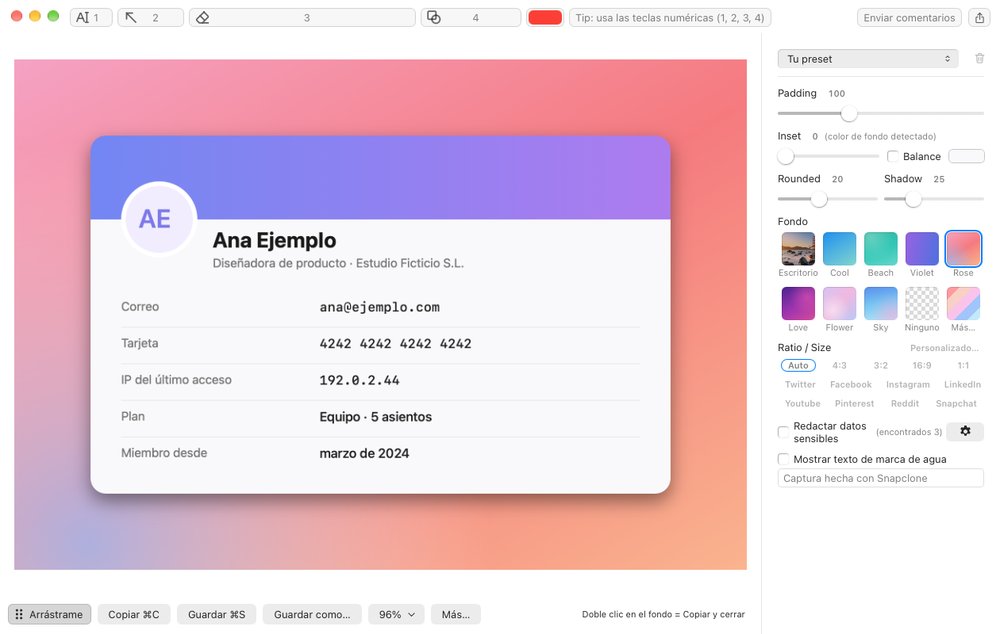
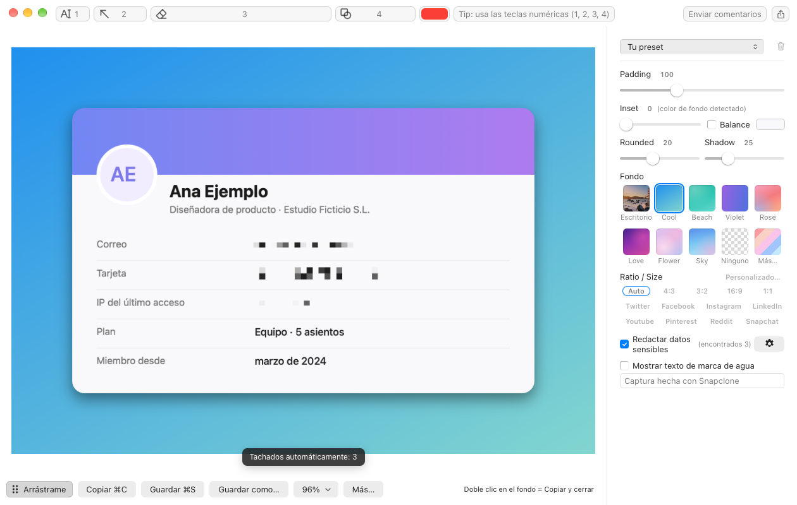
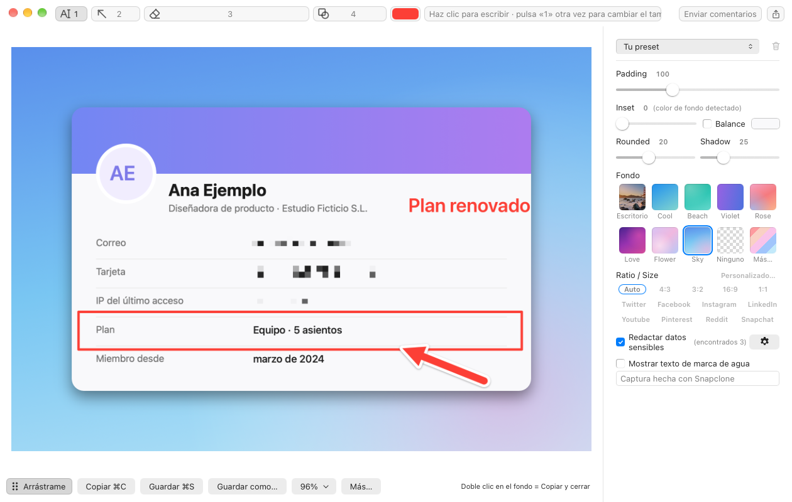
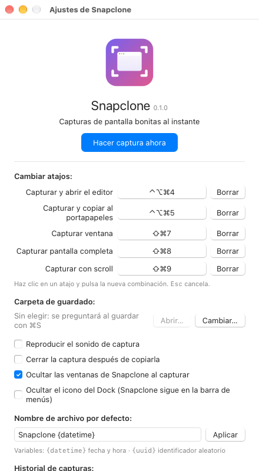
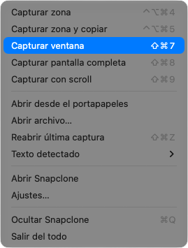

# Snapclone

Snapclone es una app de barra de menús para macOS que hace capturas de pantalla y las deja listas para compartir: fondo, margen, esquinas, sombra, anotaciones y tachado automático de datos sensibles.

> Estado: versión 0.x, en desarrollo activo. Hasta la 1.0 puede haber cambios de comportamiento entre versiones.



## Funciones

- Captura de zona, ventana, pantalla completa y con scroll, con atajos configurables.
- «Capturar zona y copiar»: copia el resultado al portapapeles sin abrir el editor.
- Editor con fondo (degradados o tu fondo de escritorio difuminado), margen, inset, esquinas, sombra, proporciones y tamaños para redes sociales.
- Anotaciones: flecha, rectángulo, texto y pixelado o tapado.
- Tachado automático de correos, tarjetas, IP y claves, gracias al reconocimiento de texto de Vision.
- Historial de capturas, texto detectado, abrir imágenes desde un archivo o el portapapeles, arrastrar y compartir.

## Capturas

Todos los datos que aparecen son inventados.

| Tachado automático | Anotaciones |
|---|---|
|  |  |

| Ajustes | Menú de la barra |
|---|---|
|  |  |

## Requisitos

- macOS 13 (Ventura) o posterior, en Apple Silicon o Intel.
- Permiso de **Grabación de pantalla** (Ajustes del Sistema → Privacidad y seguridad). Snapclone lo pide la primera vez que haces una captura.

## Instalación

1. Descarga `Snapclone_<versión>_universal.dmg` de la [última release](https://github.com/yosnap/snapclone/releases/latest). El mismo fichero vale para Apple Silicon e Intel.
2. Opcional: comprueba que la descarga está íntegra comparando su suma con la del fichero `.sha256` de la release:
   ```sh
   shasum -a 256 ~/Downloads/Snapclone_*_universal.dmg
   ```
3. Abre el `.dmg` y arrastra **Snapclone** a la carpeta **Aplicaciones**.
4. Abre Snapclone desde Aplicaciones. Aparece como un icono en la barra de menús, arriba a la derecha, y también en el Dock. Si prefieres que solo esté en la barra de menús, activa «Ocultar el icono del Dock» en Ajustes.

La app está firmada con Developer ID y notarizada por Apple, así que macOS la abre sin avisos de seguridad.

### Primera captura y permiso de Grabación de pantalla

La primera vez que hagas una captura, macOS pedirá el permiso de **Grabación de pantalla**:

1. Pulsa **Abrir Ajustes del Sistema** en el aviso, o ve a Ajustes del Sistema → Privacidad y seguridad → Grabación de pantalla y audio del sistema.
2. Activa **Snapclone**.
3. Si macOS te lo pide, cierra y vuelve a abrir Snapclone.

Sin ese permiso, las capturas salen vacías o solo con el fondo de escritorio.

### Atajos por defecto

| Captura | Atajo |
|---|---|
| Zona, que se abre en el editor | ⌃⌥⌘4 |
| Zona, que se copia al portapapeles | ⌃⌥⌘5 |
| Ventana | ⇧⌘7 |
| Pantalla completa | ⇧⌘8 |
| Con scroll | ⇧⌘9 |

Puedes cambiarlos en el menú de Snapclone → Ajustes… Si un atajo no responde, puede que otra app o el propio macOS lo esté usando: revisa Ajustes del Sistema → Teclado → Funciones rápidas de teclado.

### Actualizar

Descarga el `.dmg` de la nueva versión y arrastra Snapclone a Aplicaciones, sustituyendo la anterior. Tus ajustes y tu historial se conservan.

### Desinstalar

1. Cierra Snapclone desde su menú → Salir del todo.
2. Borra `Snapclone.app` de Aplicaciones.
3. Si quieres borrar también tus ajustes, el historial y la caché:
   ```sh
   rm -rf ~/Library/Application\ Support/com.paulo.snapclone ~/Library/Caches/com.paulo.snapclone
   ```
4. Opcional: quita Snapclone de Ajustes del Sistema → Privacidad y seguridad → Grabación de pantalla y audio del sistema.

## Desarrollo

Para compilar Snapclone desde el código o contribuir, consulta [CONTRIBUTING.md](CONTRIBUTING.md). El procedimiento de release está en [docs/release.md](docs/release.md).

## Licencia

Snapclone se distribuye con licencia [MIT](LICENSE). Las licencias de las bibliotecas de terceros que incluye están en [THIRD-PARTY-NOTICES.txt](THIRD-PARTY-NOTICES.txt), que también va dentro de la app (`Snapclone.app/Contents/Resources`).

Snapclone es un proyecto independiente, sin relación con Xnapper ni con sus autores.
